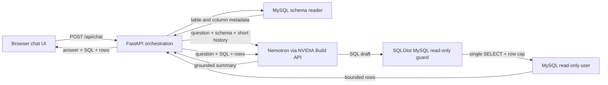

# QueryPilot AI

An MVP conversational SQL analyst for MySQL, using the NVIDIA Nemotron hosted API.

## Architecture

The workflow is deterministic and two-stage (draft SQL, execute safely, summarize results); the model does not autonomously choose tools. The browser sends one question to FastAPI. The backend reads schema metadata from MySQL, provides it with a bounded conversation history to the model, validates the returned SQL, executes it, and asks the model to summarize only the returned rows.

## Run with Docker Compose

1. Copy `.env.example` to `.env` and set `NVIDIA_API_KEY`, `MYSQL_PASSWORD`, and a private local-only `MYSQL_ROOT_PASSWORD`.
2. Run `docker compose up --build`.
3. Open `http://127.0.0.1:8000`. The MySQL container initializes a small sample dataset and creates the application account with `SELECT` permission only.

MySQL initialization runs only on the first startup, while its named volume is empty. To start over, remove the local `mysql_data` volume with Docker Compose's volume removal command.

## Run the API without Docker

Create a MySQL database, load `mysql/init/001_schema.sql`, and create a dedicated account with `SELECT` permission only. Create and activate a virtual environment, install `requirements.txt`, copy `.env.example` to `.env`, then start the server with `uvicorn app.main:app --reload`. Open `http://127.0.0.1:8000`.

The NVIDIA Build API defaults to `https://integrate.api.nvidia.com/v1` and model `nvidia/nemotron-3.5-lightning-30b-a3b`. Keep `.env` private.

## Safety boundaries

- The SQL parser accepts one MySQL `SELECT` query and applies a maximum row limit.
- MySQL execution requests a read-only transaction; database grants remain the primary permission boundary.
- Use a demo database and credentials with access only to the tables needed by the application. `MYSQL_ALLOWED_TABLES` optionally narrows schema metadata included in prompts.
- Model output, prompts, and database text are untrusted. The app does not execute generated Python.
- The API currently has no login or multi-user authorization. Bind it to localhost for local development; do not expose it to the public internet.

## Next MVP increments

Add a sample schema/data seed, authentication or deployment-level access control, conversation persistence, explicit query confirmation, and focused tests for SQL validation and database failures before any shared deployment.

.\.venv\Scripts\python.exe -m uvicorn app.main:app --reload